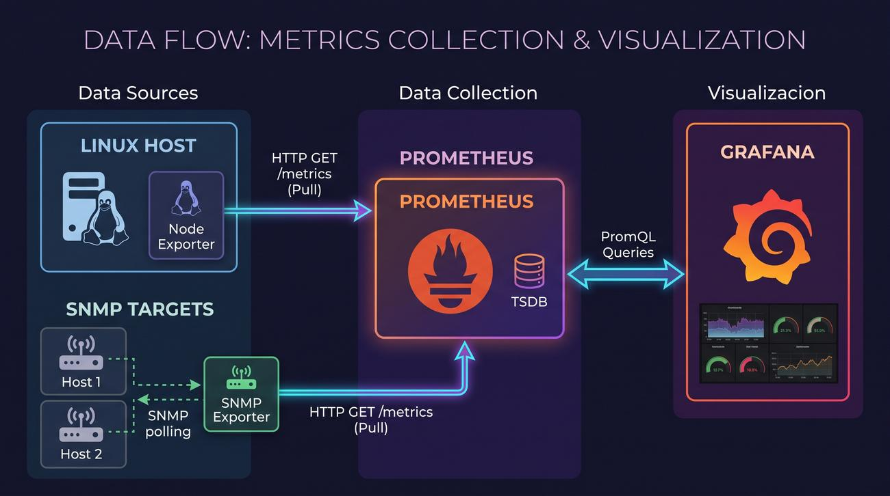

# Network Monitoring Stack — Prometheus + SNMP Exporter + Node Exporter + Grafana

Docker Compose based network / host monitoring stack. All services run in containers on a single Docker host and share one user-defined bridge network (`monitoring`).

> **Note:** all IP addresses in this document and in `prometheus/prometheus.yml` (e.g. `192.168.53.1`, `192.168.53.6`, `192.168.53.139`) are **examples**. Replace them with the real addresses of your own devices.

---

## 1. Quick Start Tutorial

### 1.1. What is this stack?

This is a lightweight, containerized network and host monitoring stack. It monitors network devices (like MikroTik RouterOS, Cisco etc.) and SNMP-enabled Linux servers (interface traffic, system resources, device health) as well as the Docker host itself (CPU, memory, disk via Node Exporter). Prometheus collects all metrics in one time-series database, and Grafana visualizes them as dashboards and graphs.

### 1.2. Architecture illustration


*Figure placeholder: service dependency / scrape-flow diagram*

### 1.3. Prerequisites

- Linux host with Docker Engine + Docker Compose v2 plugin (verified with Docker `29.6.1` / Compose `v5.3.1`).
- TCP ports free on the host: `3000` (Grafana), `9090` (Prometheus), `9100` (Node Exporter), `9116` (SNMP Exporter).
- SNMP enabled on monitored devices (this stack uses SNMP **v2c**, community `public` — see §6).
- No other files needed; images are pulled automatically from Docker Hub.

### 1.4. Run it (3 commands)

```bash
cd /home/anowak/monitoring-grafana

# 1. Pull images (optional, `up` does it anyway)
docker compose pull

# 2. Start the whole stack in the background
docker compose up -d

# 3. Check status
docker compose ps
docker compose logs -f
```

Expected result: 4 containers `Up`:

| Container | Image | Host port |
|---|---|---|
| `prometheus` | `prom/prometheus:v3.5.0` | `9090` |
| `node-exporter` | `prom/node-exporter:v1.9.1` | `9100` |
| `snmp-exporter` | `prom/snmp-exporter:v0.28.0` | `9116` |
| `grafana` | `grafana/grafana:11.6.5` | `3000` |

### 1.5. Open the UIs

| Service | URL | Credentials |
|---|---|---|
| Grafana | `http://<docker-host-ip>:3000` | user `admin`, password `zaq12wsx` |
| Prometheus | `http://<docker-host-ip>:9090` | no login |
| Node Exporter metrics | `http://<docker-host-ip>:9100/metrics` | no login, raw text |
| SNMP Exporter | `http://<docker-host-ip>:9116/snmp?module=if_mib&auth=public_v2&target=<device-ip>` | no login |

Replace `<docker-host-ip>` with your Docker host address (`localhost` if you run the browser on the same machine).

### 1.6. Verify it works (2 minutes)

1. Prometheus → `Status → Targets` (`http://<host>:9090/targets`): all jobs (`prometheus`, `node-exporter`, `snmp`, `snmp-mikrotik`, `snmp-linux`, `snmp-routeros`) should be `UP`. `DOWN` almost always means wrong example IP or SNMP not enabled on the device.
2. Grafana → log in as `admin` / `zaq12wsx` → `Connections → Data sources → Prometheus` should be green (`http://prometheus:9090`). Run a test query in `Explore`, e.g. `up` or `node_cpu_seconds_total`.
3. SNMP spot check in the browser:
   `http://<host>:9116/snmp?module=if_mib&auth=public_v2&target=192.168.53.6` (example IP) should return Prometheus exposition text, not an error.

Done. The rest of this README explains operations, config files, and data flow in detail.

---

## 2. What Is in This Stack

```text
monitoring-grafana/
├── docker-compose.yml                        # all 4 services, network, volumes
├── prometheus/
│   └── prometheus.yml                        # scrape jobs, intervals, relabeling
├── snmp_exporter/
│   └── snmp.yml                              # SNMP auth + MIB modules (generator file)
└── grafana/
    └── provisioning/
        └── datasources/
            └── prometheus.yml                # auto-provisioned Prometheus datasource
```

### Services overview

| Service | Role | Listens | Stores data? |
|---|---|---|---|
| **Prometheus** | Central time-series DB. Actively **scrapes** (pulls) metrics over HTTP on a schedule and stores them 30 days. | `9090` | Yes, volume `prometheus_data` → `/prometheus` |
| **Node Exporter** | Agent exposing Docker **host** OS/hardware metrics (`/proc`, `/sys`). Does not store anything. | `9100` `/metrics` | No |
| **SNMP Exporter** | Translator/proxy: receives an HTTP scrape from Prometheus, performs one or more SNMP GET/WALK queries against a network device, translates the result into Prometheus text format. Does not store anything. | `9116` `/snmp` | No |
| **Grafana** | Visualization. Queries Prometheus via PromQL, renders dashboards. Datasource is auto-provisioned. | `3000` | Yes, volume `grafana_data` → `/var/lib/grafana` (dashboards, users, settings) |

All containers are attached to the Docker network `monitoring` and reach each other by **service name as DNS hostname** (`prometheus`, `node-exporter`, `snmp-exporter`). Published host ports are only for you / debugging; inter-container traffic uses the internal ports.

---

## 3. How It Works — Who Collects Data from Whom

Prometheus uses a **pull model**: nothing pushes to it; Prometheus scrapes HTTP endpoints.

```text
                          SNMP (UDP 161)
  ┌──────────────┐  GET/WALK  ┌───────────────┐  GET /snmp?module=..&target=.. ┌────────────┐  PromQL   ┌─────────┐
  │ MikroTik /   │◄───────────│ snmp-exporter │◄───────────────────────────────│ prometheus │◄──────────│ grafana │
  │ RouterOS,    │            │    :9116      │         every 60 s             │   :9090    │  HTTP API │  :3000  │
  │ Linux SNMP   │            └───────────────┘                                └────────────┘           └─────────┘
  └──────────────┘                                                                    ▲
                                                                                      │ GET /metrics every 15 s
                                              host /proc,/sys                         │
                                     ┌────────────────────┐                           │
                                     │   node-exporter    │───────────────────────────┘
                                     │      :9100         │
                                     └────────────────────┘
```

1. **Node Exporter → host.** Mounts host `/proc`, `/sys`, `/` read-only (`/host`) and exposes kernel/host metrics at `:9100/metrics`. Prometheus scrapes it every **15 s** (`job: node-exporter`).
2. **SNMP Exporter → network devices.** On each scrape Prometheus calls e.g.
   `http://snmp-exporter:9116/snmp?module=mikrotik&auth=public_v2&target=192.168.53.6`.
   The exporter looks up `auth: public_v2` (SNMPv2c, community `public`) and `module: mikrotik` (which OIDs to walk) in `snmp.yml`, queries the device over SNMP, and returns Prometheus-formatted metrics. Prometheus does this every **60 s** with a **55 s** timeout (SNMP walks are slow).
3. **Prometheus → exporters + itself.** `prometheus.yml` defines 6 jobs (see §5). `relabel_configs` rewrite the target so Prometheus contacts `snmp-exporter:9116` while keeping the real device IP in the `instance` label.
4. **Grafana → Prometheus only.** Grafana never contacts exporters or devices. Its provisioned datasource points to `http://prometheus:9090` (Docker-internal URL) and queries via PromQL. This is why Grafana keeps working even if you don't publish exporter ports on the host.

---

## 4. Docker Operations — Start, Stop, Restart

All commands run from the repo root (where `docker-compose.yml` lives).

### Start

```bash
docker compose up -d            # start all, detached
docker compose up -d prometheus # start only one service
docker compose ps               # show state
```

### Stop / start / restart

```bash
docker compose stop             # stop all (containers + network stay, data in volumes stays)
docker compose start            # start stopped stack again
docker compose restart          # restart all
docker compose restart snmp-exporter   # restart one service (e.g. after editing snmp.yml)
```

### Logs and health

```bash
docker compose logs -f                # follow all
docker compose logs -f prometheus     # one service
docker ps --filter "name=prometheus|grafana|exporter"
curl -s http://localhost:9090/-/healthy   # Prometheus readiness: "Prometheus Server is Healthy."
curl -s http://localhost:3000/api/health  # Grafana health JSON
```

### Reload config without restart

```bash
# Prometheus only (enabled via --web.enable-lifecycle in compose):
curl -X POST http://localhost:9090/-/reload
# Then check Status → Targets. If you edited prometheus.yml with a syntax error,
# reload fails safely and the old config keeps running.
```

> SNMP Exporter and Node Exporter have **no** reload endpoint — after editing `snmp_exporter/snmp.yml` you must `docker compose restart snmp-exporter`. Grafana provisioning files are only read at container start — restart Grafana after changing them.

### Stop completely / wipe

```bash
docker compose down             # stop + remove containers and network, KEEP volumes (data safe)
docker compose down -v          # DANGER: also deletes prometheus_data + grafana_data (all history + dashboards)
```

### Update images

```bash
docker compose pull
docker compose up -d
```

### Validate before you start (what was tested)

```bash
docker compose config                                    # must print merged YAML without errors
docker run --rm \
  -v ./prometheus/prometheus.yml:/etc/prometheus/prometheus.yml:ro \
  --entrypoint /bin/promtool \
  prom/prometheus:v3.5.0 check config /etc/prometheus/prometheus.yml
# expected: SUCCESS: ... is valid prometheus config file syntax
```

---

## 5. Configuration Files

### 5.1. `docker-compose.yml` (orchestration)

- **Project/network/volumes:** project name `monitoring-grafana`, one bridge network `monitoring`, two named volumes `prometheus_data` (30 days of metrics) and `grafana_data` (dashboards, users).
- **`prometheus`** (`prom/prometheus:v3.5.0`): flags `--config.file`, `--storage.tsdb.path=/prometheus`, `--storage.tsdb.retention.time=30d`, `--web.enable-lifecycle` (allows `/-/reload`). Mounts `prometheus.yml` read-only + data volume. Port `9090`. `restart: unless-stopped`.
- **`node-exporter`** (`prom/node-exporter:v1.9.1`): flag `--path.rootfs=/host` so host paths resolve correctly. Mounts `/proc`, `/sys`, `/` from the **host** read-only. Port `9100`.
- **`snmp-exporter`** (`prom/snmp-exporter:v0.28.0`): mounts custom `snmp.yml` read-only to `/etc/snmp_exporter/snmp.yml` (the image default path — no explicit `--config.file` flag needed). Port `9116`.
- **`grafana`** (`grafana/grafana:11.6.5`): env `GF_SECURITY_ADMIN_USER=admin`, `GF_SECURITY_ADMIN_PASSWORD=zaq12wsx`, `GF_USERS_ALLOW_SIGN_UP=false`. Mounts data volume + `./grafana/provisioning` read-only. Port `3000`. `depends_on: prometheus` (start order only — Compose does not wait for Prometheus to be ready).

### 5.2. `prometheus/prometheus.yml` (what is scraped)

Globals: `scrape_interval: 15s`, `scrape_timeout: 10s`, `evaluation_interval: 15s`.

| `job_name` | Target(s) | Via | Module / notes |
|---|---|---|---|
| `prometheus` | `prometheus:9090` | direct | Self-monitoring. |
| `node-exporter` | `node-exporter:9100` | direct | Label `host="docker-host"`. Host CPU/mem/disk. |
| `snmp` | `192.168.53.6` (ex.) label `device="MT_BIURO"` | `snmp-exporter:9116` | `module: [if_mib]`, generic interface MIB. 60 s / 55 s timeout. |
| `snmp-mikrotik` | `192.168.53.6` (ex.) | `snmp-exporter:9116` | `module: [mikrotik]` — MikroTik enterprise MIB. |
| `snmp-linux` | `192.168.53.139` (ex.) label `host="serwer-linux-snmp"` | `snmp-exporter:9116` | `modules: [ucd_la_table, ucd_memory, ucd_system_stats]` — Net-SNMP `UCD-SNMP-MIB` load/memory/system stats. Requires `snmpd` on the Linux box. |
| `snmp-routeros` | `192.168.53.6`, `192.168.53.1` (ex.) | `snmp-exporter:9116` | `module: [routeros]` — RouterOS MIB. |

How the SNMP jobs work (`relabel_configs`, identical in all four):

1. `__address__` (e.g. `192.168.53.6`) → `__param_target` (becomes the `?target=` query parameter).
2. `__param_target` → `instance` (so graphs show the device IP, not the exporter).
3. `__address__` overwritten with `snmp-exporter:9116` (the actual HTTP host Prometheus scrapes).

`metrics_path: /snmp` and `params: {module: [...], auth: [public_v2]}` build the final URL.

### 5.3. `snmp_exporter/snmp.yml` (SNMP auth + MIB modules)

- **Header warning is real:** the file was generated by the [snmp_exporter generator](https://github.com/prometheus/snmp_exporter/tree/main/generator) from MIBs; hand edits are overwritten next time someone regenerates. Small tweaks (community, adding a target) belong in `prometheus.yml`, not here.
- **`auths:`** defines two SNMP credentials; this stack uses `public_v2` = SNMP **v2c**, community `public`, `noAuthNoPriv`. `public_v1` is defined but unused. Change the community here if your devices use a custom one (and keep `auth: [your_auth]` in sync in `prometheus.yml`). SNMP v2c sends the community in cleartext — use ACLs / management VLAN in production.
- **`modules:`** each module = a set of OID subtrees to `walk`/`get` + metric mappings. This file ships ~35 modules (`if_mib`, `mikrotik`, `routeros`, `cisco_*`, `apcups`, `synology`, `printer_mib`, …). Only the ones referenced in `prometheus.yml` are actually scraped:
  - `if_mib` — standard `IF-MIB` interfaces (`ifInOctets`, `ifOutOctets`, oper status…).
  - `mikrotik` — `MIKROTIK-EXPERIMENTAL-MIB` (wireless, LTE, health where supported).
  - `routeros` — `MTXR-WIRELESS`/`system` RouterOS stats.
  - `ucd_la_table` / `ucd_memory` / `ucd_system_stats` — Net-SNMP load average, memory/swap, CPU counters from `UCD-SNMP-MIB`.
- The file is ~44k lines because every OID needs an explicit metric definition — that is normal for `snmp.yml`.

### 5.4. `grafana/provisioning/datasources/prometheus.yml` (datasource)

```yaml
- name: Prometheus
  type: prometheus
  isDefault: true
  url: http://prometheus:9090   # Docker-internal DNS, NOT localhost
```

Grafana reads this at startup and creates a default, editable Prometheus datasource. No manual datasource setup needed. No dashboards/alerts are pre-provisioned — import or create them in the UI (they persist in `grafana_data`).

---

## 6. Adapting to Your Network

1. **Change target IPs:** edit `static_configs → targets` in `prometheus/prometheus.yml`, then `curl -X POST localhost:9090/-/reload`.
2. **Change SNMP community:** edit `community: public` under `auths → public_v2` in `snmp_exporter/snmp.yml`, then `docker compose restart snmp-exporter`. For SNMPv3/authPriv you must regenerate `snmp.yml` with the generator (out of scope of this file).
3. **Add a device:** copy one `static_configs` block (e.g. under `snmp-routeros`), change IP + `device` label, reload Prometheus.
4. **Change retention:** edit `--storage.tsdb.retention.time=30d` in `docker-compose.yml`, then `docker compose up -d prometheus`.
5. **Change Grafana password:** edit `GF_SECURITY_ADMIN_PASSWORD` in `docker-compose.yml`, then `docker compose up -d grafana`. (Changing it later from the UI is fine too — the env var only seeds the initial admin on first start with an empty volume.)

---

## 7. Troubleshooting

| Symptom | Likely cause / fix |
|---|---|
| Prometheus target `DOWN`, `context deadline exceeded` on an `snmp-*` job | Wrong example IP, device offline, SNMP disabled, wrong community, UDP 161 blocked. Test from the exporter host: `snmpwalk -v2c -c public <device-ip> 1.3.6.1.2.1.1`. Note the 55 s timeout — SNMP walks on slow devices are normal. |
| `snmp` job UP but `snmp-mikrotik` DOWN for same IP | Device answers generic `IF-MIB` but not the MikroTik enterprise MIB (SNMP package disabled on RouterOS, or non-MikroTik device). |
| Grafana datasource test fails | Prometheus container not ready / wrong URL. Inside Docker it must be `http://prometheus:9090`, not `localhost`. Check `docker compose ps` and Grafana logs. |
| `docker compose up` fails: port already allocated | Something already uses 3000/9090/9100/9116. Change the left side (`"3001:3000"`) or stop the conflicting process. |
| Edited `prometheus.yml`, reload fails | Syntax error — validate with the `promtool check config` command from §4. |
| Edited `snmp.yml`, nothing changed | Forgot `docker compose restart snmp-exporter` (no reload endpoint). |
| Need a clean slate | `docker compose down` keeps data; `down -v` deletes it. Back up volumes before `-v`. |

---

## 8. Reference

- Images (pinned in `docker-compose.yml`): Prometheus `v3.5.0`, Node Exporter `v1.9.1`, SNMP Exporter `v0.28.0`, Grafana `11.6.5`.
- Upstream docs: [Prometheus configuration](https://prometheus.io/docs/prometheus/latest/configuration/configuration/), [snmp_exporter](https://github.com/prometheus/snmp_exporter), [Node Exporter](https://github.com/prometheus/node_exporter), [Grafana provisioning](https://grafana.com/docs/grafana/latest/administration/provisioning/#data-sources).
- Security note: default credentials `admin` / `zaq12wsx` and SNMPv2c community `public` are **not production-safe**. Change both, restrict published ports / bind to management interface, and keep SNMP on a management VLAN with device ACLs.
